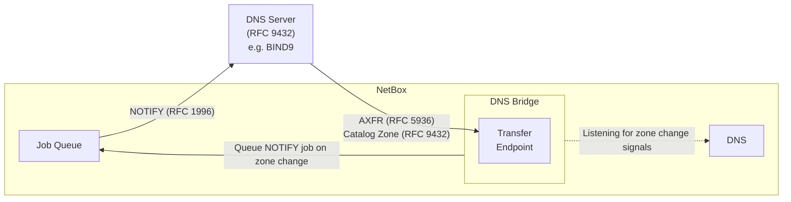

# NetBox DNS Bridge

The NetBox DNS Bridge plugin extends [NetBox DNS](https://github.com/sys4/netbox-plugin-dns) by
embedding a lightweight DNS server directly within NetBox. It acts as a bridge between NetBox DNS
and your existing DNS infrastructure, leveraging native DNS mechanisms for seamless integration.
These include zone transfers (RFC 5936), catalog zones (RFC 9432), and notifying clients about zone
changes (RFC 1996).

<a href="https://pypi.org/project/netbox-plugin-dns-bridge/">

</a>
<a href="https://github.com/Suraxius/netbox-plugin-dns-bridge/stargazers">

</a>
<a href="https://github.com/Suraxius/netbox-plugin-dns-bridge/network/members">

</a>
<a href="https://github.com/Suraxius/netbox-plugin-dns-bridge/issues">

</a>
<a href="https://github.com/Suraxius/netbox-plugin-dns-bridge/pulls">

</a>
<a href="https://github.com/Suraxius/netbox-plugin-dns-bridge/graphs/contributors">

</a>
<a href="https://github.com/Suraxius/netbox-plugin-dns-bridge/blob/master/LICENSE">

</a>
<a href="https://github.com/psf/black">

</a>
<a href="https://pepy.tech/project/netbox-plugin-dns-bridge">

</a>
<a href="https://pepy.tech/project/netbox-plugin-dns-bridge">

</a>
<a href="https://pepy.tech/project/netbox-plugin-dns-bridge">

</a>

## Contents

- [Overview](#overview)
- [Compatibility](#compatibility)
- [Requirements](#requirements)
- [Installation](#installation)
- [Configuration](#configuration)
  - [Settings reference](#settings-reference)
  - [Catalog zone naming](#catalog-zone-naming)
  - [TSIG authentication](#tsig-authentication)
  - [NOTIFY](#notify)
- [Running the transfer endpoint](#running-the-transfer-endpoint)
- [Notes and troubleshooting](#notes-and-troubleshooting)
- [License](#license)

## Overview



- **Zone transfers (RFC 5936)** — DNS servers pull authoritative zone data directly from NetBox.
- **Catalog zones (RFC 9432)** — consumers automatically discover newly created and deleted zones.
  One catalog zone is exposed per view and may be queried through the built-in DNS server just like
  any other zone. The catalog zone name is configurable (see
  [Catalog zone naming](#catalog-zone-naming)) and defaults to `catz`.
- **NOTIFY (RFC 1996)** — clients and zone nameservers are informed about zone changes so they can
  request a fresh zone transfer (see [NOTIFY](#notify)).
- **Views and TSIG** — each view requires its own TSIG key, which is also used to map incoming
  requests to the correct view (see [TSIG authentication](#tsig-authentication)).
- **DNSSEC** — not supported yet; will be added once BIND9 provides a mechanism to configure it
  through the catalog zones system.

## Compatibility

This plugin extends netbox-plugin-dns, and versioning is aligned with it: the major and minor
version of both plugins must match. For example, when using netbox-plugin-dns `v1.5.5`, install
netbox-plugin-dns-bridge `v1.5.x`.

| netbox-plugin-dns | netbox-plugin-dns-bridge |
| :---------------: | :----------------------: |
| 1.5.x             | 1.5.x                    |
| 1.6.x             | 1.6.x                    |
| 1.7.x             | 1.7.x (current)          |

NetBox and Python version requirements follow netbox-plugin-dns; see its
[documentation](https://github.com/sys4/netbox-plugin-dns).

## Requirements

- [NetBox](https://github.com/netbox-community/netbox) with the
  [netbox-plugin-dns](https://github.com/sys4/netbox-plugin-dns) plugin installed.
- A DNS server with RFC 9432 catalog zone support (e.g. BIND9) as the consumer.
- Network reachability from the consumer to the NetBox host on TCP and UDP port `5354` (or the
  port you have configured).
- At least one running `rq-worker` service if you enable any of the NOTIFY features, since they
  use NetBox's background job system.

## Installation

The full walkthrough — including a complete BIND9 configuration with two views — is available in
[docs/installation-guide.md](docs/installation-guide.md). The short version:

1. Install the package:

    ```
    cd netbox
    echo netbox-plugin-dns-bridge >> local_requirements.txt
    . venv/bin/activate
    pip install -r local_requirements.txt
    ```

2. Enable the plugin in `configuration.py`:

    ```python
    PLUGINS = ['netbox_dns', 'netbox_dns_bridge']
    ```

3. Configure the plugin under `PLUGINS_CONFIG` (see [Configuration](#configuration)).

4. Run migrations:

    ```
    manage.py migrate
    ```

5. Start the transfer endpoint as a background service (see
   [Running the transfer endpoint](#running-the-transfer-endpoint)).

## Configuration

Plugin settings are configured under `PLUGINS_CONFIG` in `configuration.py`:

```python
PLUGINS_CONFIG = {
    'netbox_dns_bridge': {
        ...
    }
}
```

### Settings reference

| Setting | Type | Default | Description |
| ------- | ---- | ------- | ----------- |
| `catalog_zone_name` | string | `catz` | Name of the catalog zone exposed for each view |
| `catalog_zone_name_includes_view` | bool | `False` | Prepend the view name: `<view>.<catalog_zone_name>` |
| `tsig_keys` | dict | — | Per-view TSIG keys used to authenticate transfers and sign NOTIFY messages |
| `notify_over_tcp` | bool | `False` | Send NOTIFY messages over TCP instead of UDP |
| `notify_clients` | bool | `False` | NOTIFY clients that have queried the transfer endpoint |
| `notify_client_alive_threshold_hours` | int | `24` | How long a client is considered "alive" after its last query |
| `notify_client_port` | int | `53` | Destination port for client NOTIFY messages |
| `notify_ns_custom_field_name` | string | — | Boolean zone custom field enabling NS NOTIFY per zone |
| `notify_ns_all_zones` | bool | `False` | Send NS NOTIFY for every zone on serial change |
| `notify_ns_port` | int | `53` | Destination port for NS NOTIFY messages |

### Catalog zone naming

The name of the catalog zone exposed for each view is configurable:

| Setting | Default | Description |
| ------- | ------- | ----------- |
| `catalog_zone_name` | `catz` | The name of the catalog zone. May be a full DNS name. |
| `catalog_zone_name_includes_view` | `False` | Prepend the view name: `<view>.<catalog_zone_name>`. |

`catalog_zone_name` accepts full DNS names with multiple labels. Case and a trailing dot are
irrelevant — names are handled and compared as `dns.name.Name` objects. With
`catalog_zone_name_includes_view` disabled (the default), the plain `catalog_zone_name` is used for
every view; when enabled, the view name is prepended (e.g. `_default_.catz`).

```python
'netbox_dns_bridge': {
    'catalog_zone_name': 'catz',
    'catalog_zone_name_includes_view': False,
    ...
}
```

Note that the DNS server consuming the catalog zone must be configured with the same zone name,
e.g. BIND9's `catalog-zones { zone "<catalog_zone_name>" ... }` statement and the corresponding
slave zone declaration must match.

### TSIG authentication

The TSIG keys allow clients to query the transfer endpoint and are also used to sign NOTIFY
messages sent to clients on zone changes. Each view should have its own unique key so the plugin
can identify the view the client is trying to access. Reusing a key for multiple views yields
unpredictable behavior.

```python
'tsig_keys': {
    'the-view-name-here': {
        'keyname': 'the-tsig-key-name-here',
        'algorithm': 'hmac-sha256',
        'secret': 'xxxxxxxxxxxxxxxxxxxxxxxxxxxxxxxxxxxxxxxxxxxx'
    }
}
```

The `keyname`, `algorithm` and `secret` attributes form a dictionary under the following Python
structure path:

```
PLUGINS_CONFIG.netbox_dns_bridge.tsig_keys.<dns_view_name>
```

### NOTIFY

The plugin has 2 different NOTIFY mechanisms that may be turned on individually or together.

1. [Client NOTIFY](#client-notify) — notify clients that are regularly contacting the transfer
   endpoint for zone updates.
2. [NS NOTIFY](#ns-notify) — notify the zone's NS servers when a zone changes.
   - [Per zone](#ns-notify-per-zone) — for zones that have a specific custom field set to true.
   - [For all zones](#ns-notify-for-all-zones) — for all zones. This makes the *per zone*
     mechanism redundant; there is no point in enabling both.

#### Global NOTIFY settings

```
'notify_over_tcp': True
```

Switch to using TCP instead of UDP. Defaults to `False`.

#### Client NOTIFY

Clients may be notified of zone changes using the NOTIFY mechanism defined in RFC 1996. When
enabled, the zone transfer endpoint keeps track of any client that successfully queried the
endpoint. Once a zone has changed, NetBox informs each client that the zone changed so that the
client can request a new zone transfer.

Note that this feature uses NetBox's background job system to schedule the messages
asynchronously. In order to work, you need at least one `rq-worker` service running in the
background to handle the queued jobs.

```
'notify_clients': True
```

This enables the NOTIFY system. Defaults to `False`.

```
'notify_client_alive_threshold_hours': 24
```

This sets how long a client is considered "alive" after it last queried the transfer endpoint. Once
the client has failed to check in for this amount of time, it is automatically removed from the
list of clients to be notified on zone changes. Default is 24 hours.

```
'notify_client_port': 53
```

Destination port used to send NOTIFY messages to clients. Defaults to 53.

#### NS NOTIFY

In addition to notifying clients that queried the transfer endpoint, the plugin can send a NOTIFY
directly to a zone's own nameservers whenever that zone's SOA serial number changes. This is useful
when you want nameservers to pull updates immediately, independent of the `notify_clients`
mechanism. Only a change of the SOA serial triggers this — other zone edits that leave the serial
untouched do not.

This can be enabled per zone, globally, or both. If neither of the settings below is configured,
the feature is disabled entirely.

##### NS NOTIFY per zone

This uses a True/False custom field attached to each zone to enable/disable NOTIFY for each
individually.

Create a boolean custom field (e.g. `dns_bridge_notify_ns`) that applies to `netbox_dns > zone`,
then point the plugin at it:

```python
'notify_ns_custom_field_name': 'dns_bridge_notify_ns'
```

A NOTIFY is then sent for any zone whose custom field is set to `True`. This lets you toggle the
behavior per zone straight from the NetBox UI, without changing the plugin config.

##### NS NOTIFY for all zones

```
'notify_ns_all_zones': True
```

When enabled, a NOTIFY is sent for every zone on serial change, regardless of the custom field.
Defaults to `False`. The two options coexist: a NOTIFY is sent if the global switch is on **or**
the zone's custom field is set.

##### NS NOTIFY settings

The nameserver addresses are resolved from NetBox DNS itself by looking up active A/AAAA records
(within the zone's view) matching each nameserver's hostname. The NOTIFY messages are signed with
the same per-view TSIG key configured under `tsig_keys`, so the receiving nameservers must accept
NOTIFY signed with that key (e.g. BIND's `allow-notify { key "..."; };`).

```
'notify_ns_port': 53
```

Destination port used for these NOTIFY messages. Defaults to 53.

As with the client NOTIFY feature, this uses NetBox's background job system, so at least one
`rq-worker` service must be running.

## Running the transfer endpoint

To start the transfer endpoint in the foreground:

```
manage.py dns-transfer-endpoint --port 5354
```

| Parameter | Description |
| --------- | ----------- |
| `--port` | Port to listen on for requests (defaults to 5354) |
| `--address` | IP of interface to bind to (defaults to 0.0.0.0) |

This process needs to run as a background service for the built-in DNS server to work correctly.
For Linux users with systemd (Ubuntu, etc), Matt Kollross provides a startup unit and instructions
in [docs/install-systemd-service.md](docs/install-systemd-service.md). Remember to activate the
venv when running the service in the background.

## Notes and troubleshooting

- **TSIG key reuse** — each view must have its own unique TSIG key. Reusing a key across multiple
  views yields unpredictable behavior, since the plugin uses the key to map requests to views.
- **Catalog zone name mismatch** — the zone name configured on the consumer (e.g. BIND9's
  `catalog-zones { zone "..." }` statement and the corresponding slave zone declaration) must match
  the plugin's `catalog_zone_name` setting.
- **NS NOTIFY not firing** — NS NOTIFY is only triggered by a change of the zone's SOA serial
  number. Other zone edits that leave the serial untouched do not trigger a NOTIFY.
- **NOTIFY jobs are not sent** — both NOTIFY mechanisms require at least one `rq-worker` service to
  be running, since the messages are scheduled through NetBox's background job system.

## License

This project is licensed under the [MIT License](LICENSE.md).
